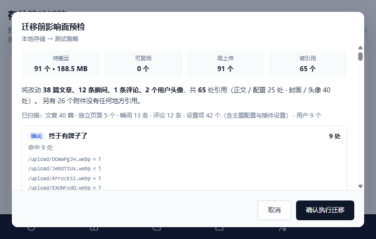
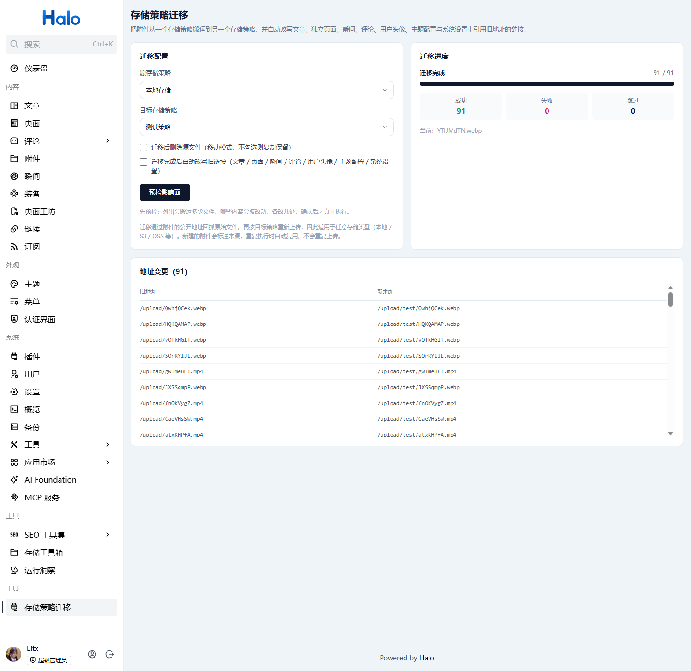

# 存储策略迁移（storage-migrator）

Halo 插件：把一个存储策略下的附件搬运到另一个存储策略，并自动改写文章、独立页面、瞬间、用户头像、主题配置与系统设置中引用旧地址的链接。

## 解决什么问题

Halo 的附件分散在不同存储策略（本地 / S3 / OSS / 对象存储插件）里。当你想把某个策略下线、换存储服务商、或者把附件从本地迁到云上时，
Halo 本身不提供批量迁移能力——你只能一个个下载再上传，而且旧文章里的图片地址不会跟着变，迁完就全是裂图。

这个插件做三件事：

1. **批量搬运附件**：从源策略读取文件，按目标策略重新上传，生成归属新策略的附件记录；
2. **可选删除源文件**：移动模式（清理旧存储）或复制模式（保留双份，先验证再删）；
3. **改写引用地址**：扫描文章与独立页面的正文（Markdown 源码 + 渲染后的 HTML）与封面、瞬间的内容与媒体、用户头像，以及系统 / 插件设置和主题配置（ConfigMap），把指向旧地址的链接替换成新地址。

## 使用方式

控制台 → **工具 → 存储策略迁移**

1. 选择源存储策略和目标存储策略（下拉里会显示各自的文件数和占用体积）；
2. 选择模式：
   - 不勾选「迁移后删除源文件」= 复制（推荐先跑这个，验证无误后再迁移）；
   - 勾选 = 移动（目标上传成功后才删源）；
3. 勾选「迁移完成后自动改写链接」（默认开启）；
4. 点击「预检影响面」：弹窗先列出**会搬运多少文件**（可复用 / 需上传 / 有引用 / 无引用），以及
   **哪些内容会被改、各改几处**（文章 / 页面 / 瞬间 / 主题配置 / 系统设置 / 用户头像，正文几处、封面或头像几处、对应哪个旧地址）；
5. 确认无误后点「确认执行迁移」，页面才会真正开始搬文件，并实时显示进度、失败明细和地址变更表。

预检是纯只读的，不会上传文件、不会写文章，随便点多少次都没副作用。影响面算不准时它也很有用：
如果预检显示「没有内容引用这些附件的旧地址」，说明这次迁移只搬文件、不改内容。

任务可重复执行：新建的附件会标注来源（注解 `storage-migrator/from-attachment`），再次执行时按来源复用
已有副本，不会重复上传。目标策略改了文件名的场景（如 S3 的随机文件名模式，`test-image.png` 变成
`80215383.png`）同样能命中，不再依赖「同名」判断。

## 界面预览

**迁移配置**：选择源 / 目标存储策略，决定是否删除源文件、是否自动改写链接：


**预检影响面**：执行前先看清会搬多少文件、哪些内容会被改、各改几处：



**迁移结果**：实时进度、成功 / 失败 / 跳过统计，以及完整的地址变更表：



## HTTP API

挂载在 `/apis/api.console.halo.run/v1alpha1/storage-migrator` 下：

| 方法 | 路径 | 说明 |
| --- | --- | --- |
| GET | `/policies` | 列出存储策略及附件数量、总大小 |
| POST | `/preview` | 迁移前影响面预检（body: `sourcePolicy` / `targetPolicy`），只读 |
| POST | `/tasks` | 创建迁移任务（body: `sourcePolicy` / `targetPolicy` / `deleteSource` / `rewriteLinks`） |
| GET | `/tasks` | 任务列表 |
| GET | `/tasks/{id}` | 任务详情与进度 |
| POST | `/rewrite` | 仅改写链接（body: `urlMapping` + `dryRun`），可先预演 |

`/rewrite` 可以单独使用：传 `{"urlMapping":{"旧地址":"新地址"},"dryRun":true}` 先看会影响多少内容，确认后再 `dryRun=false` 落地。

## 实现原理

### 附件搬运

附件的 `status.permalink` 对任何存储策略都是公开可访问的，因此插件用 `WebClient` 回抓源文件字节流，
再调用 Halo 的 `AttachmentService.upload(policyName, groupName, filename, Flux<DataBuffer>, mediaType)`
以目标策略重新入库。这样不依赖具体存储实现，本地 / S3 / OSS 一视同仁。

上传会校验认证，所以任务创建时会把发起请求的 `SecurityContext` 显式带进后台任务的 Reactor 上下文。

移动模式（勾选「迁移后删除源文件」）删除源附件时调的是 `ReactiveExtensionClient.delete(attachment)`，
不是 `AttachmentService.delete`：后者只调用存储 handler 删文件，不会删 Attachment 记录，用它移动会留下
指向已删除文件的孤儿记录。删除记录后由 `attachment-manager` finalizer 的 reconciler 收尾，
存储对象也在那一步真正删掉。

### 链接改写

Halo 的文章正文不在 Post 上，而是存在 **Snapshot 的 patch 链**里：

- `baseSnapshot` 的 `rawPatch` / `contentPatch` 就是**全文**；
- 其余快照（`headSnapshot` 草稿、`releaseSnapshot` 已发布版本）存的是**相对 base 的 diff**。

所以改写流程是：还原全文 → 字符串替换 → 用 `PatchUtils.diffToJsonPatch` 重新对 base 求 diff 并写回，
同时清掉 Snapshot 上的 `PATCHED_RAW_ANNO` / `PATCHED_CONTENT_ANNO` 缓存注解。

Markdown 源（`rawPatch`）和 HTML（`contentPatch`）两份都会改。只改 HTML 的话，用户下次在编辑器里保存会把旧链接写回来。

替换时除原样匹配外，还会匹配 URL 编码后的形式（中文文件名常见），并且只在 **URL 边界**上替换：
命中位置前后紧贴域名/路径字符时不算命中，避免把 `https://example.com/upload/x.png` 改成
`https://example.comhttps://cdn...`。

相对路径的映射还会额外匹配「站点绝对地址」写法：正文 / 评论里常写着
`http://localhost:8090/upload/x.png`（本地调试、换域名前的老内容），而映射里只有 `/upload/x.png`，
按边界规则前面紧贴 `8090` 是匹配不上的。这类**本机地址**（`localhost` / `127.0.0.1` / `[::1]`，
任意端口和协议）会连域名端口一起换掉；第三方域名下的同路径不动，避免改坏别人的图床。
站点地址能正常解析时（`ExternalUrlSupplier` 或 `halo.external-url`），还会额外展开一份完整地址。

**映射范围 = 历史上所有迁移过的附件 + 本次任务新产生的映射**（前者来自迁移附件上的
`storage-migrator/from-permalink` 标注）。只认本次任务的话，一旦上一次任务被打断
（进程重启、插件重载、中途取消），那批文件对应的文章 / 瞬间就永远改不到，重跑也补不上；
改成全量映射后，重跑一次任务即可把遗留的旧地址一起补掉，预检也会把这些遗留条目算进影响面。

文章与独立页面的封面（`spec.cover`）独立判断、独立改写，即使正文没有引用旧地址也会处理。

除文章/页面外，以下位置同样会被扫描和改写：

| 位置 | 存放形式 | 处理方式 |
|---|---|---|
| 系统设置 / 插件设置 | `ConfigMap` 的 `data`（各键是 JSON 字符串） | 逐键做字符串替换；带 `storage.halo.run/policy-owner` 标签的策略配置会被跳过 |
| 主题配置 | `theme-<名称>-configMap` 的 `data` | 同上，归类为「主题配置」单独计数 |
| 瞬间 | moments 插件的扩展 `moment.halo.run/v1alpha1 Moment` | 改写 `spec.content.raw`、`spec.content.html` 与 `spec.content.medium[].url` |
| 评论 / 回复 | `content.halo.run/v1alpha1` 的 `Comment` / `Reply` | 同时改写 `spec.raw`（Markdown 原文）与 `spec.content`（渲染后的 HTML）；审核状态、置顶、作者等字段不动 |
| 用户头像 | `User` 的 `spec.avatar` + `halo.run/avatar-attachment-name` 注解 | 改头像地址，并把注解指向迁移后的新附件；昵称 / 邮箱 / 密码等字段原样保留 |

瞬间是插件定义的扩展类型，插件编译期拿不到它的类，所以先通过 `SchemeManager` 按 GVK 查出注册的类型再列举，
读写统一走 `Unstructured`（原始 Map），这样插件自己加的字段不会在更新时被丢掉。

**头像为什么要单独处理**：Halo 的头像权威来源不是 `spec.avatar`，而是 `User` 上的
`halo.run/avatar-attachment-name` 注解（存的是**附件记录名**）。`UserReconciler.handleAvatar` 会按这个注解
找到附件、算出 permalink 再反写 `spec.avatar`。移动模式下源附件记录已被删除，注解若还指着旧附件，
reconciler 会一直 `Requeue ... Avatar permalink(...) is not available yet`，头像就再也出不来。
所以迁移时除了按地址映射改写 `spec.avatar`，还会把注解换成迁移后的新附件名。

### 影响面预检

预检不需要知道目标策略生成的新地址（S3 会把文件名重写成随机串），因为**会被改哪些内容只取决于源附件的
permalink**，所以能在真正上传之前算准。

统计口径和真实改写完全同源：把每个旧地址替换成唯一占位符，直接走一遍 `applyMappings`
（同样的 URL 边界、站点绝对地址展开、URL 编码变体），再数占位符出现次数。这样「预检说改 3 处」和
「执行后改了 3 处」不会打架。

「被引用」按**本次参与改写的全部旧地址**统计（含「同一迁移」的历史地址，见下），
「无引用」只数源策略里那些没有任何内容引用的附件。

改写范围 = 本次任务搬走的文件 + **同一次迁移**（同一源策略 → 同一目标策略）以前搬走的文件。
后者是为了应对「任务跑到一半被打断、重跑只搬了剩下的文件」：那批先搬走的文件要靠附件上的
`storage-migrator/from-permalink` 标注把旧地址补回来。**不会**把别的策略搬走的文件算进来，
否则只搬 1 个文件也可能显示成 2 处引用。判断依据是附件上的 `storage-migrator/from-policy` 标注；
老版本迁移出来的附件没有这个标注，退化用「它现在落在本次的目标策略里」推断。

正文按 `headSnapshot`（草稿，没有草稿时用 base）的全文算；封面单独计数并单独提示。
设置项按 `data` 里所有值合起来统计，用户头像按 `spec.avatar` 计。

**同一份内容的多种表示只算一处引用**：文章 / 页面的 `rawPatch` 与 `contentPatch`、评论的 `raw` 与 `content`、
瞬间的 `raw` / `html` / `media[].url`，都是同一段内容的不同形态，一张图会在这些地方各出现一次。
统计时按「每个旧地址在这些表示里的**最大**出现次数」合并，而不是相加 —— 否则一张图会被显示成两处引用。
改写时这些表示仍然全部替换，只是「处数」按引用算。同一张图在一份内容里真的出现两次，才会算 2 处。

> 头像在预检里归到「封面 / 头像」合计里：`User.spec.avatar` 是单个图片地址字段，
> 和封面一样属于「专用图片字段」，不与正文处数混在一起。

## 已知限制

1. **只重写当前可见的快照**（base / head / release）。更早的历史版本不会重算，
   若回滚到旧版本，内容里的链接可能仍是旧地址。
2. **不会更新第三方内容**：自定义 HTML 区块、主题模板文件（`themes/` 下的源码）不在扫描范围内。
   评论 / 回复已支持（见上），瞬间只处理 moments 插件，其它插件自定义的扩展类型默认不扫描。
3. **本地存储策略的「存储位置」必须填相对路径**（相对于 `attachments` 根目录，如 `attachments2`）。
   填绝对路径会触发 Halo 的目录穿越保护（`Directory traversal detected`）。
4. 任务状态存在内存里，插件重启后历史任务列表会清空（迁移产物本身已落库，不受影响）。
5. 迁移速度是串行的，按文件逐个搬运；大文件多时会比较慢，属预期行为。

## 开发

```bash
./gradlew build              # 构建插件（含前端）
./gradlew reloadPlugin -Pport=8090   # 热重载到本地运行的 Halo
cd ui && pnpm dev            # 前端 watch 构建
```

前端页面位于 `ui/src/views/MigrationView.vue`。

### 两个前端构建注意点

- Halo 只认固定名 `ui/main.js` 作为插件前端入口，而 vite 产出的是带 hash 的 `main.<hash>.js`，
  所以 `build.gradle` 里的 `processUiResources` 会额外复制一份固定名。
- 插件页面**不能依赖 Halo 控制台的 Tailwind 类**（构建时不会扫描插件源码，大量类不生效，
  表现为按钮白底白字看不见）。样式一律写在组件的 `<style scoped>` 里。

## 许可证

[GPL-3.0](./LICENSE) © litx
